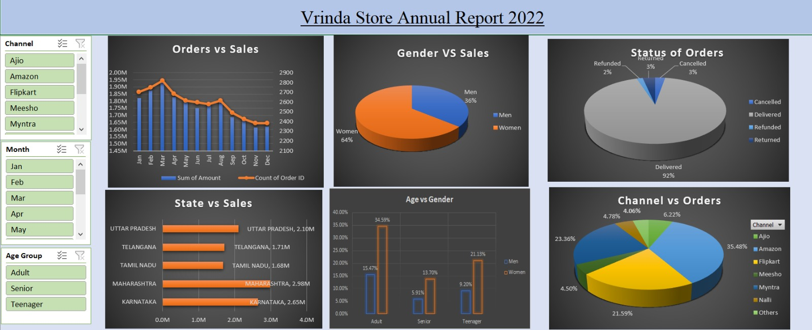

# Vrinda Store: Annual Sales Analysis 2022

An interactive Excel dashboard that turns a year of online fashion orders into answers about customers, channels, regions and order outcomes.

**Tools:** Excel · Pivot Tables · Pivot Charts · Slicers · Formulas (IF, TEXT)

**Quick links:** [Full report (PDF)](Vrinda_Store_Sales_Report.pdf) · [Excel dashboard](Vrinda_Store_Data_Analysis_Dashboard.xlsx)

---

## Business problem

Vrinda Store wants an annual report for 2022 that shows who its customers are, where and through which channels they buy, and how orders turn out, so it can plan growth for 2023. The data is one raw sheet of 31,047 rows, which is hard to use directly. This project summarises it into a one-page dashboard that a non-technical user can filter.

## Key numbers

| Gross sales | Order lines | Avg per order line | Delivered |
|---|---|---|---|
| ₹2.12 crore | 31,047 | ₹682 | 92.25% |

## Key findings

- **Women drive the business:** 64% of sales, but men spend about 27% more per order line (₹802 vs ₹629).
- **Sales peak in March and fade to November:** a 16.2% decline, caused by fewer orders rather than smaller baskets.
- **Five states generate 52.5% of sales:** Maharashtra, Karnataka, Uttar Pradesh, Telangana and Tamil Nadu.
- **Three marketplaces bring 80.4% of orders:** Amazon (35.5%), Myntra (23.4%) and Flipkart (21.6%).
- **7.75% of order lines are returned, cancelled or refunded,** representing about ₹14.66 lakh (6.9% of sales), at similar rates on every channel.
- **Adults aged 30 to 49 are the largest segment,** and women place about 2.2 to 2.3 times as many order lines as men in every age group.

## Recommendations

1. Focus campaigns on women aged 30 to 49 and on the high-value "Set" category (49.6% of sales).
2. Test menswear bundles, since men's order value is higher.
3. Reduce dependence on three marketplaces by growing smaller channels.
4. Investigate returns and cancellations by category, size and SKU.
5. Plan a second-half demand push, after confirming the trend with clean date data.

## Approach

1. Reviewed 21 columns, date range, currency and statuses; checked for blanks and duplicates.
2. Added helper columns with formulas: `Age Group` (`=IF(Age>=50,"Senior",IF(Age>=30,"Adult","Teenager"))`) and `Month` (`=TEXT(Date,"mmm")`).
3. Built five pivot tables for sales and orders by month, gender, status, state and channel.
4. Chose a chart for each question: combo chart (two axes), pie charts, bar chart, clustered columns.
5. Connected three slicers (Channel, Month, Age Group) to every chart.
6. Assembled everything on one sheet, "Annual Report 2022".

## Dataset

- Public practice dataset of online fashion store orders (not real client data)
- 31,047 order lines (28,471 unique Order IDs) · 28,437 customers · year 2022 · currency INR
- Key fields: Order ID, Cust ID, Gender, Age, Date, Status, Channel, SKU, Category, Size, Qty, Amount, ship-state

## Repository contents

| File | Description |
|---|---|
| [`Vrinda_Store_Sales_Report.pdf`](Vrinda_Store_Sales_Report.pdf) | Full report: problem, method, findings, recommendations, limitations |
| [`Vrinda_Store_Sales_Dashboard.xlsx`](Vrinda_Store_Data_Analysis_Dashboard.xlsx) | Excel workbook with the raw data, pivot tables and dashboard |
| [`images/dashboard.jpeg`](DashboardScreeshot.jpeg) | Dashboard screenshot |

## How to open the dashboard

Download the `.xlsx` file and open it in desktop Excel (2016 or later). Use the slicers on the left of the **Annual Report 2022** sheet to filter every chart at once.

## Limitations

- Counts are **order lines**, not unique orders.
- All records fall on the 4th to 6th of each month (36 distinct dates), so the monthly trend should be validated against the source system before forecasting.
- Total sales is **gross** and includes returned, cancelled and refunded lines; delivered-only sales are ₹1.97 crore.
- The "Teenager" label covers ages 18 to 29; "Young adult" would be more accurate.
- The data has no cost or margin, so results describe sales, not profit.

---

**Author:** Abhijit Sharma · Part of the [Excel Data Analytics Portfolio](../README.md)
